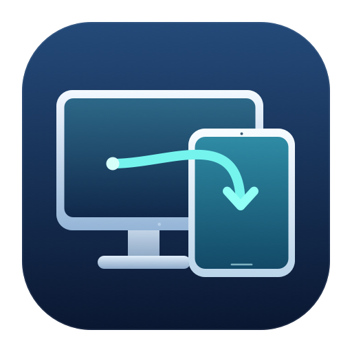

# 屏幕接力 · ScreenRelay



让 Mac 桌面适合正在远程连接的 iPad 或 iPhone。

屏幕接力是配合 **UU 远程 + BetterDisplay** 使用的 macOS 菜单栏工具：连接时接管设备专属虚拟屏，结束后恢复原来的实体屏与光标设置。

## 能做什么

- 每台设备绑定自己的 BetterDisplay 虚拟屏，分别记住方向、分辨率与光标倍率。
- 横竖屏切换、HiDPI 显示大小选择，iPhone 刘海／灵动岛留白设置。
- 远程时只保留目标虚拟屏；恢复时核验实体屏的模式、主屏、位置和布局保护。
- 1×–4× 远程光标；提供 Excel、PowerPoint 专用加载项安装及启用指引。
- 菜单栏面板、设备工作台、开机自启、辅助功能授权引导和恢复实体屏快捷键。
- 隐藏或最小化 UU 窗口时保留已确认的会话；断开、后台重启与异常恢复保留持久化记录。

## 下载与安装

在 [Releases](https://github.com/CMD-cmd/ScreenRelay/releases) 下载 Apple Silicon 安装包，解压后阅读其中的安装说明，再运行 `Install.command`。

这是开发预览版本，尚未使用 Apple Developer ID 签名或进行 Apple 公证，macOS 的安全检查可能阻止运行。也可以审阅源码后自行构建。当前提供的二进制面向 **Apple Silicon、macOS 14 或更新版本**，本机验证环境为 macOS 27；其他系统版本与设备组合仍需实际验证。

安装需要 Apple Command Line Tools 提供的 `/usr/bin/python3`，并需要另外安装 UU 远程与 BetterDisplay；BetterDisplay 的部分功能需要其专业版授权，本项目不包含这些软件或其许可证。

1. 首次安装后在系统设置中授予屏幕接力辅助功能权限，按应用内引导核验。
2. 在 BetterDisplay 中启用“允许断开所有已连接的显示器”。
3. 在设备工作台选择或添加设备配置，确认 UU 设备名称绑定、方向、显示大小及光标倍率。
4. 打开“自动接力”，连接 UU 后等待虚拟屏接管。

安装默认暂停自动接力。更新前先在旧版中恢复实体屏并暂停，安装程序会保留配置与备份。恢复实体屏并暂停的快捷键是 **Control + Option + Command + 9**。

## Office 光标

“设备工作台 → 连接与启动 → Office 光标”中分别准备 Excel 和 PowerPoint 加载项，然后按指引在 Office 的加载项管理器中启用。加载项会在对应 Office 进程内运行本机光标模块。软件核验实际加载状态，并随当前设备倍率调整；全局宏安全设置保持原样。

应用自行绘制的指针和部分非位图动画可能无法采用相同方式缩放；系统或 Office 更新后需重新验证。

## 从源码构建

需要支持 macOS 26 界面 API 的 Xcode／Swift 工具链及 Python 3.9 或更新版本。

```sh
bash script/build_and_run.sh --build-only
python3 script/install.py
```

构建脚本生成 `dist/UUDisplayAutomation.app` 和运行所需助手。安装写入当前用户的 Applications、Application Support 和一个 LaunchAgent，不修改全局 Office 宏保护。

```sh
python3 -m unittest discover -s tests -v
```

完整 Office 模板读回检查可在单独开发环境安装 `olefile`、`oletools` 后运行；这两项不是软件运行依赖。当前发布导出经过独立构建与回归检查；硬件、UU／BetterDisplay／Office 更新可能影响兼容性。

## 隐私与权限

辅助功能权限用于识别 UU 被控会话，macOS 授予的权限本身也具备控制界面的能力。屏幕接力的配置、连接设备名、恢复记录和诊断日志保存在当前用户的 `~/Library/Application Support/UUDisplayAutomation/`，项目未添加遥测或云端同步。

公开仓库及下载包排除本机运行目录、真实设备标识、开发聊天、验收截图、日志、备份和签名凭据。提交问题前，请检查日志和截图中的用户名、设备名及路径。

## 使用许可

本项目原创部分采用 [PolyForm Noncommercial 1.0.0](LICENSE.md)，提供源码公开和条款规定的非商业使用、修改与分发。商业用途需要维护者另行授权，可通过 GitHub Issue 联系。

这属于非商业源码许可，并非 OSI 定义的开源许可。第三方组件仍遵循各自原许可，详见 [第三方声明](THIRD_PARTY_NOTICES.md)。本项目与 UU 远程、BetterDisplay、Apple、Microsoft 无隶属关系。
